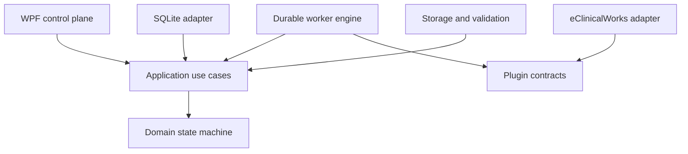

# Architecture

## Boundaries

Dependencies point inward:

- **Domain** contains the state machine and entities. It references only Shared.
- **Application** contains commands and ports; it has no EF Core or WPF dependency.
- **PluginContracts** contains stable vendor-facing DTOs and interfaces, never EF entities.
- **Infrastructure**, **SQLite**, **PluginHost**, and **Worker** implement application ports.
- **WPF** composes the host and exposes operator controls.
- **eClinicalWorks** depends only on PluginContracts, Shared, and the standard HTTP factory abstraction.

## Control and data planes

SQLite is the control plane: jobs, events, manifests, file metadata, retries, leases, audit, settings, and schema version. The managed filesystem is the data plane: exact manifests, NDJSON, checksums, and `local-commit.json`. Network I/O never occurs inside a database transaction.

## Kickoff crash boundary

The worker builds the vendor request URI and commits a `KickoffDispatchPrepared` record before sending it. If the process ends after this journal commit but before a confirmed response is saved, restart moves the job to `Unknown` instead of replaying `$export`. This deliberately prefers operator/vendor reconciliation over a duplicate export.

When HTTP 202 is received, the exact absolute `Content-Location` value is written with the state event in one SQLite transaction. Subsequent polling and DELETE operations use only that stored value.

## Plugin isolation

Built-in adapters are dependency-injected. External adapters are discovered from one controlled plugin directory using `AssemblyLoadContext` and `AssemblyDependencyResolver`. The host checks manifest compatibility and SHA-256 trust before loading. Assembly load contexts isolate dependencies; they are not security sandboxes.

## Background-service evolution

The worker engine has no WPF dependency. It can move to a Windows Service later while retaining the Domain, Application, Persistence, Infrastructure, and plugin layers. A future UI/service split should use authenticated local IPC and a single writer for the same database.

