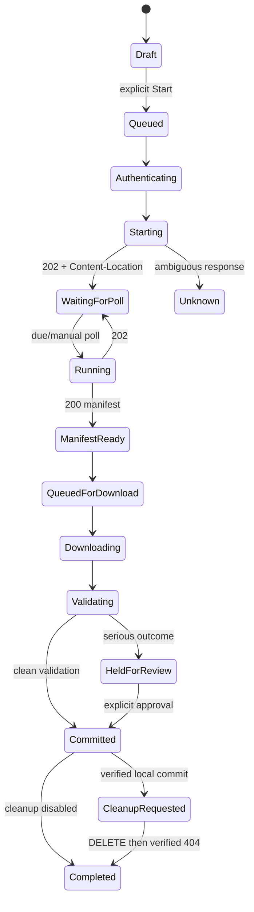

# Export lifecycle

The legal state graph is encoded in `Domain/ExportJob.cs`; arbitrary state strings are not accepted.

Pause is a local state and never issues DELETE. Cancel Remote Export and Cleanup Remote Export both require typed confirmation, but apply at different stages and always target the original polling URL. Local deletion never implies remote deletion.

HTTP 200 means only that a manifest was returned. It does not mean files were downloaded, valid, locally committed, or remotely cleaned up.

